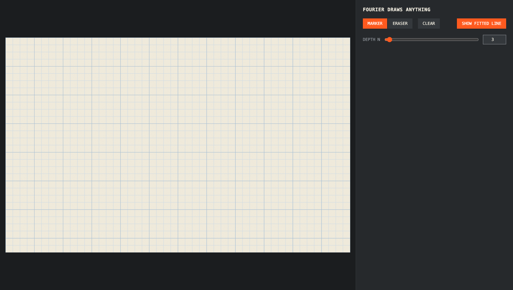
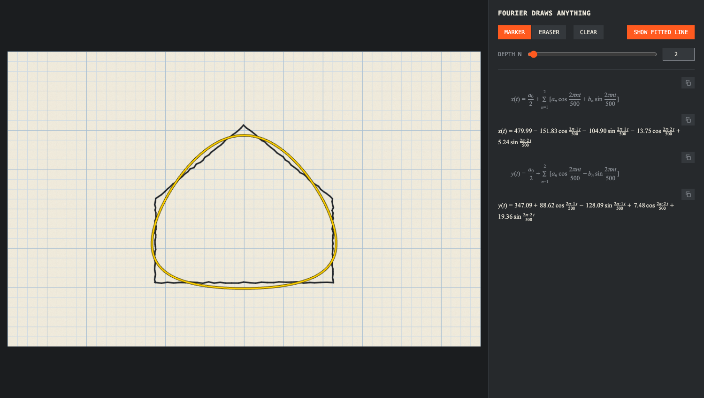
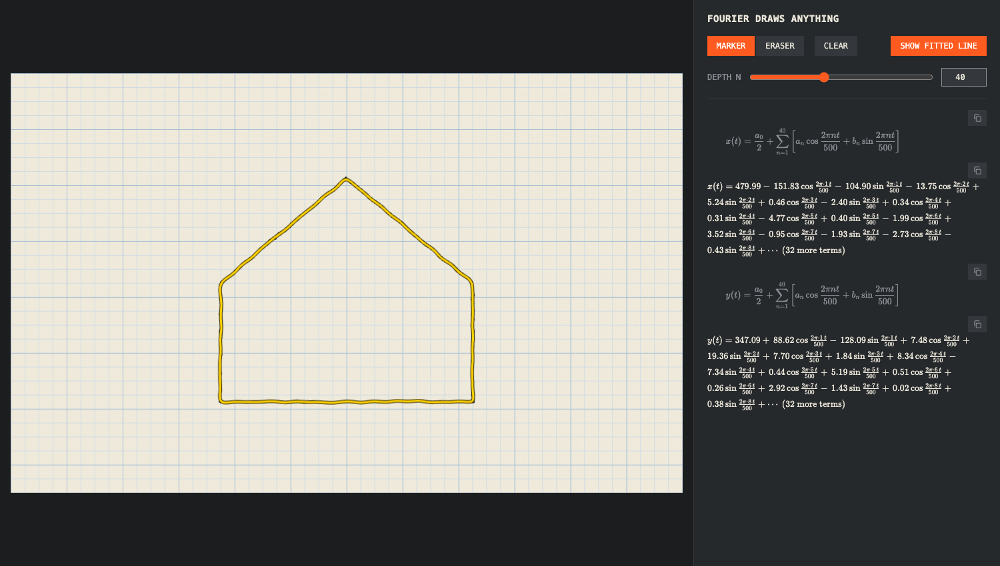
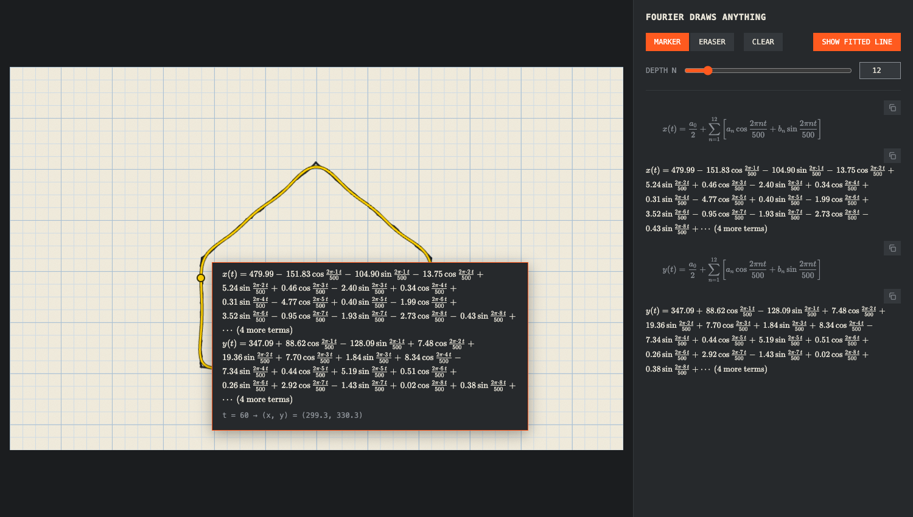

# Fourier Draws Anything

Draw anything on a notebook-style canvas, pick a depth **N**, and watch a Fourier series redraw it in yellow.



## Run

```
docker compose up --build
```

Open http://localhost:8000.

Without Docker:

```
uv run uvicorn main:app
```

## Usage

1. **Draw** with the marker. Use **Eraser** to remove ink and **Clear** to start over.
2. **Pick a depth N** with the slider (0–100) or type any value up to 250 in the box.
3. The yellow curve is a Fourier series of that depth fitted to your drawing.
4. **Show fitted line** hides or shows the yellow curve.
5. The sidebar shows the equations behind it. The copy icon next to each one copies its LaTeX.
6. **Hover over the yellow line** to see the equations at that point, with the matching `t` and `(x, y)`.

### Low depth: a rounded blob



### Higher depth: the shape sharpens



### Hover to see the equation behind the line



## How it works

A drawing is not a function of x, so the series is fitted to the pen's path instead. The path is resampled to 500 evenly spaced points `(x(t), y(t))`, and a separate Fourier series is fitted to `x(t)` and to `y(t)`:

```
f(t) = a0/2 + Σ (aₙ cos(2πnt/T) + bₙ sin(2πnt/T))
```

- A series is periodic, so the path is closed into a loop. If your end point is near your start (within 5% of the path length) it is used as is. Otherwise the stroke is retraced backwards, so an open line becomes out-and-back along itself.
- The maths is in `fourier.py`, written as plain loops that follow the notebook in `experimental/`. `main.py` is a small FastAPI server and the UI is `static/index.html`.
- The equations are rendered with KaTeX loaded from a CDN, so the page needs internet access to typeset them.
